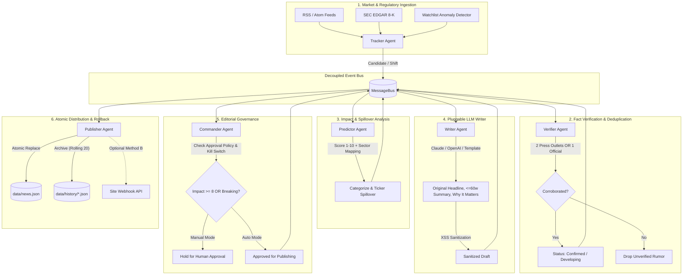

# 📰 Titan War Multi-Agent Newsroom

An autonomous, multi-agent financial newsroom written in Python 3.11+ that discovers, verifies, analyzes, writes, and publishes real-time intelligence on Big Tech giants, corporate shifts, and sudden market volatility.

Stories are published automatically and atomically to your web platform's [`data/news.json`](file:///c:/Users/gurka/OneDrive/Desktop/New%20folder%20%282%29/data/news.json) or dispatched via authenticated webhook API.

---

## 🏛️ Architecture & Agent Topology

All six agents communicate through a decoupled in-memory message bus (`newsroom.bus`) and share a centralized security and utility toolkit (`newsroom.tools`).



---

## 🤖 The 6 Specialized Agents

| Agent | Responsibility | Key Policies & Outputs |
|---|---|---|
| **Tracker** | Scout news feeds, SEC EDGAR, and ticker prices. | Detects price moves $\ge X\%$, volume $Z$-scores $\ge 2.5$, and breaking keywords. |
| **Verifier** | Fact-checker & deduplicator. | Requires 2 independent press sources OR 1 official source for `confirmed`. Labels single-source stories as `developing`. Drops uncorroborated rumors. |
| **Predictor** | Senior Market Analyst. | Scores market impact 1–10, categorizes (`big-tech`, `corporate`, `market-shift`), and maps peer spillovers (e.g. NVDA $\rightarrow$ AMD, TSM, INTC). |
| **Writer** | Executive Financial Copywriter. | Writes 100% original headlines, summaries strictly $\le 60$ words, and a "why it matters" line. Never copies article bodies; sanitizes against XSS. |
| **Commander** | Chief Editor & Gatekeeper. | Owns the global kill switch. Pauses stories with impact $\ge 8$ or status `breaking` when `APPROVAL_MODE=manual`. |
| **Publisher** | Site Release Engineer. | Validates schema, atomically updates `data/news.json`, maintains rolling 20-version rollback history in `data/history/`. |

---

## ⚡ Quick Start

### 1. Requirements & Setup
Requires Python 3.11+.

```bash
# Navigate to the workspace and install requirements
pip install -r newsroom/requirements.txt
```

### 2. Configure Environment (Optional)
Copy `.env.example` to `.env`:
```bash
cp newsroom/.env.example newsroom/.env
```
*(If no API keys are provided, the newsroom automatically utilizes its deterministic financial synthesis engine for offline/zero-key operation).*

### 3. Run the Reference Scenario Demo
Demonstrates the complete pipeline: **NVDA falls 6% in 20 minutes on chip export restrictions**:

```bash
# Dry-run demo (validates schema, logs all agent actions, no file overwrite)
python -m newsroom.main --demo

# Live demo (commits breaking news story directly to data/news.json)
python -m newsroom.main --demo --live
```

---

## 🧪 Running Automated Pytest Suite

The test suite covers the Verifier, Predictor, Publisher, and the full end-to-end reference scenario:

```bash
python -m pytest newsroom/tests -v
```

---

## ⚙️ Sudden Shift Detection Logic

Configured in [`newsroom/config.yaml`](file:///c:/Users/gurka/OneDrive/Desktop/New%20folder%20%282%29/newsroom/config.yaml):
- **Price Move:** $| \Delta P | \ge 4.0\%$ within 20 minutes.
- **Volume Surge:** $Z = \frac{V - \mu_{20}}{\sigma_{20}} \ge 2.5$.
- **Trigger Keywords:** `export controls`, `chip ban`, `antitrust`, `subpoena`, `national security`, `earnings surprise`, `merger`, `layoffs`.
- **Default Watchlist:** `NVDA`, `AAPL`, `MSFT`, `GOOGL`, `AMZN`, `META`, `TSLA`.

---

## 🔒 Security & Reliability Principles

- **Zero Hardcoded Credentials:** All tokens loaded via `os.getenv` or `.env`.
- **XSS Sanitization:** All headlines, summaries, and why-it-matters strings are cleaned of raw tags and HTML-escaped.
- **Safe Atomic Writes:** Writes to temporary files before using `os.replace` to prevent corrupted JSON states during process termination.
- **20-Version Rolling Rollback:** Every update automatically archives the preceding `news.json` inside `data/history/`.
- **Global Kill Switch:** Set `kill_switch: true` in `config.yaml` or pass `NEWSROOM_KILL_SWITCH=true` to instantly halt all distribution channels.
